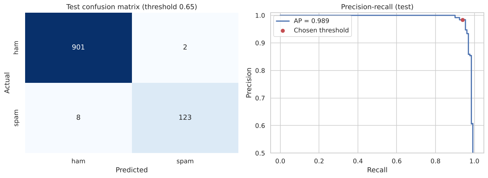
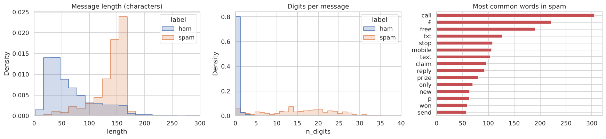
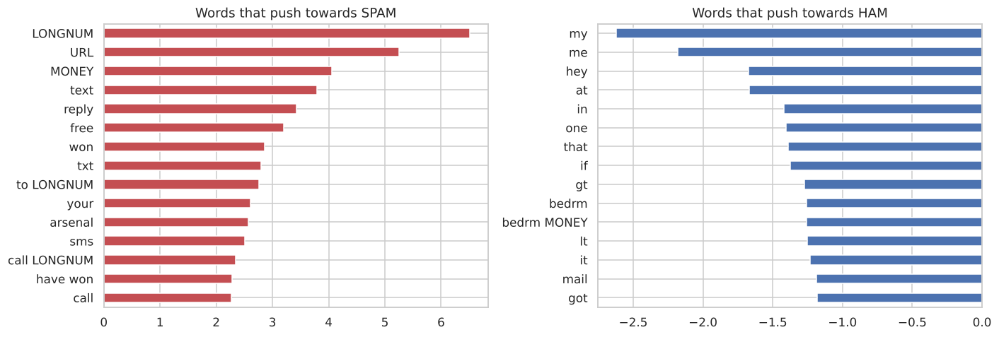

# SMS Spam Classifier

A text classifier that flags spam SMS messages and is tuned to **avoid blocking real messages**. On 1,034 unseen messages it makes 10 mistakes: 2 real messages blocked and 8 spam missed.



## The problem

87% of messages are legitimate, so a model that never flags anything is already 87% accurate. Accuracy isn't the metric to watch. What matters is the trade-off: a missed spam is annoying, but a real message lost in a spam folder is worse. So the model is tuned for **high precision**.

## Data

[UCI SMS Spam Collection](https://archive.ics.uci.edu/dataset/228/sms+spam+collection): 5,572 English SMS messages, 13% spam. After removing **403 duplicates** (repeated spam campaigns and common replies), 5,169 unique messages remain. Duplicates are removed *before* splitting, otherwise the same message can land in both train and test and inflate the score.



Spam messages average 138 characters vs 71 for real ones, and contain about 15 digits on average vs fewer than 1.

## Approach

- **Text normalisation:** URLs, money amounts (£500, 150p) and long numbers (phone numbers, shortcodes) are replaced with tokens, so the model learns "contains a prize amount" rather than memorising specific numbers.
- **Features:** TF-IDF on word n-grams **plus** character 2-5 grams. The character grams catch shortcodes and odd spellings.
- **Models compared** with 5-fold CV: Multinomial NB, Complement NB, Logistic Regression, Linear SVM.
- **Tuning:** grid search on the best model, then sigmoid calibration so the SVM outputs probabilities.
- **Threshold:** chosen on out-of-fold predictions to keep precision at or above 99%.
- **Error analysis:** read through every mistake on the test set.

## Results

| Model (5-fold CV) | Precision | Recall | F1 |
|---|---|---|---|
| **Linear SVM** | **0.986** | 0.948 | **0.967** |
| Logistic Regression | 0.984 | 0.946 | 0.965 |
| Multinomial NB | 0.960 | 0.948 | 0.954 |
| Complement NB | 0.941 | 0.948 | 0.945 |

**Test set (1,034 messages, 131 spam):** precision **98.4%**, recall **93.9%**, F1 0.961, average precision 0.989.

### What the mistakes show

- One of the two "real" messages that got blocked is actually promotional spam that was **mislabelled** in the dataset.
- Most of the missed spam is *unusual* spam: a movie quiz, a fast-food promotion, a joke. None of it uses the typical "FREE / call now / £1000" wording, which is the limit of a bag-of-words model.



## Try it

```bash
pip install -r requirements.txt
python predict.py "WINNER!! You have been selected to receive a £900 prize reward. Call 09061701461 to claim"
# SPAM  (1.00)  WINNER!! You have been selected to receive a £900 prize reward. Call 09061701461

python predict.py "Hey, are we still meeting for lunch at 1?"
# ham   (0.00)  Hey, are we still meeting for lunch at 1?
```

To retrain, run `spam_classifier.ipynb`. It overwrites `models/spam_model.joblib`.

## Next steps

- Fine-tune a small transformer (e.g. DistilBERT) to catch spam that doesn't use typical spam vocabulary
- Add structural features like premium-rate shortcodes
- Test on more recent SMS data, since spam wording changes over time
